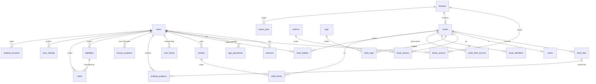

# PandaLibrary — Database design

The schema lives in migrations, not in the docs. The initial migration is
[00001_init.sql](../../internal/db/migrations/00001_init.sql). It was validated against
modernc.org/sqlite v1.61.1 (SQLite 3.54.1) and sqlc v1.31.1; see §10. How schema and data
changes are applied is in [migrations.md](./migrations.md). The overall system design is in
[system.md](./system.md).

## 1. Conventions

| Topic | Rule |
|---|---|
| Timestamps | `INTEGER` Unix **milliseconds** UTC (`*_at`). Converted to and from `time.Time` in the service layer |
| Booleans | `INTEGER` 0/1 with a `CHECK` |
| Enums | `TEXT` with a `CHECK (x IN (…))`. Adding a value means a migration that rebuilds the table (SQLite cannot alter CHECKs) |
| JSON | `TEXT` with `CHECK (json_valid(x))`, used only for opaque client payloads (locators, settings, cached provider responses) |
| Server-owned ids | `INTEGER PRIMARY KEY` (rowid alias) |
| Client-created ids | `id TEXT UNIQUE` (UUIDv7, 36 chars) **plus** `seq INTEGER PRIMARY KEY`. The UUID lets an offline device create rows idempotently; `seq` is a stable rowid for FTS (implicit rowids can change on `VACUUM`) |
| Link tables / pure key-value | `WITHOUT ROWID` with a composite primary key |
| Case-insensitive names | `COLLATE NOCASE` (ASCII only). CJK has no case, so this is sufficient |
| Foreign keys | Always declared, `PRAGMA foreign_keys=ON` on every connection. `ON DELETE CASCADE` for owned data, `SET NULL` for "who did it" references, `RESTRICT` where deletion must be deliberate (library with books, author still linked) |
| Strict tables | Not used: sqlc's SQLite parser support is not verified for them. CHECKs give the needed guarantees |

## 2. Entity overview



## 3. Tables

### Users and authentication

- **`users`**
  - `username` is unique and case-insensitive.
  - `password_hash` is an argon2id PHC string (`$argon2id$v=19$m=65536,t=3,p=4$…`).
  - `role` is `admin` or `user`.
  - `locale` drives the UI language.
  - `disabled` blocks login, sessions and app passwords without deleting the user's data.
- **`sessions`**
  - Keyed by `sha256(cookie token)` (32-byte BLOB), so a leaked database cannot be replayed
    as cookies.
  - `expires_at` is indexed for the hourly cleanup.
- **`app_passwords`**
  - `kind` is `opds` or `kosync`.
  - `secret_hash` is unique, so authentication is a single indexed lookup followed by a
    check that the username matches.
  - The kosync hash is `sha256(md5hex(secret))` because KOReader only sends the MD5.

### Configuration

- **`server_settings`** is a JSON key-value store. Keys include `default_library_id`,
  `registration` (always closed in v1), `backup.keep`, `opds.page_size` and
  `googlebooks.api_key` (or use `metadata_providers.api_token`).
- **`metadata_providers`** has one seeded row per provider.
  - A CHECK forbids enabling `neodb` or `hardcover` without a token.
  - `base_url` lets NeoDB point at any instance.
  - Tokens are never returned by the API (write-only fields).

### Libraries and visibility

- **`libraries`** has a unique name and a URL- and folder-safe `slug`, which is also the
  drop-folder subdirectory name.
- **`library_access`** contains `(library_id, user_id)` grants. Admins bypass it.
- **`book_hidden`** is a per-user per-book hide list, written by admins (`hidden_by`). It
  applies on top of library access.

### Catalog

- **`books`** has one row per work.
  - `sort_title` is computed on write (articles moved, Han → pinyin).
  - `series_index REAL` holds decimals such as 1.5. It is ordered with
    `ORDER BY series_index`, and the partial index `books_series` makes series pages cheap.
  - `published_date` is `YYYY`, `YYYY-MM` or `YYYY-MM-DD`.
  - `cover_sha256` points into `covers/`.
- **`book_files`** has one row per physical file (EPUB, PDF, … of the same book).
  - `sha256 UNIQUE` is the global duplicate check.
  - `koreader_md5` holds KOReader's partial MD5 and is indexed for kosync lookups.
- **`authors`**, **`series`** and **`tags`** are global and deduplicated case-insensitively.
  - `book_authors.role` separates author, translator, editor and illustrator, which matters
    for translated Chinese and Japanese books. `position` keeps the display order.
  - `book_authors.author_id` is `ON DELETE RESTRICT`, so the service deletes orphan authors
    explicitly.
- **`book_identifiers`** stores `(scheme, value)` pairs such as `isbn13` or `douban`. The
  `(scheme, value)` index finds "an existing book with this ISBN" at import time and is
  used for provider lookups.
- **`book_field_sources`** records where each field's value came from (`file`, `manual`, or a
  provider plus its `source_ref`). It powers the "from NeoDB" hints in the edit grid and
  "refresh from the same source".

### Shelves

- **`shelves`**
  - `kind='private'` requires an `owner_id`. `kind='shared'` (admin-created, visible to
    all) must have `owner_id IS NULL`, enforced by a CHECK.
  - Name uniqueness is per owner for private shelves and global for shared ones, through
    two partial unique indexes.
- **`shelf_books`** keeps a manual `position` and who added the book. Books a user cannot
  see are filtered out at read time.

### Per-user reading data

| Table | Key | Sync | Notes |
|---|---|---|---|
| `user_books` | (user, book) | LWW | status, rating 1–10, started/finished |
| `reading_progress` | (user, book) | LWW | **one latest position across all devices**; `book_file_id` + `source` say which locator format it is |
| `kosync_progress` | (user, KOReader digest) | — | raw KOReader record for exact KOReader↔KOReader round-trips and for unknown digests |
| `highlights` | `id` UUID | LWW + tombstone | `locator` JSON, `position` 0–1 for ordering, `text`, `color`, `chapter` |
| `notes` | `id` UUID | LWW + tombstone | `highlight_id` NULL means a book-level note; Markdown in `body_md` |
| `user_settings` | (user, key) | LWW | `reader.epub`, `reader.pdf`, `reader.book.<id>`, `ui` |
| `reading_sessions` | `id` UUID | append | client-created (web) or server-derived (KOReader) |
| `sync_counter` | singleton | — | global monotonic `rev` source |

### Import and metadata

- **`import_jobs`** is both the queue and the history. On startup the importer re-queues
  `pending` and `processing` rows. Rows are pruned after 30 days.
- **`metadata_cache`** is keyed by `(provider, request_key)`, where `request_key` is
  normalized (`isbn:<13>`, `q:<nfkc-lower title>|<author>`, `id:<ref>`).
  - `status` 200 is a hit and 404 a negative-cache entry; any other status is a short-TTL
    error.
  - `schema_version` invalidates entries after the normalizer changes.

## 4. Index strategy

Every index serves a concrete access path:

| Access path | Index |
|---|---|
| Library grid sorted by title / recently added | `books_library_sort_title`, `books_library_created_at` |
| Series page in order | `books_series` (partial) |
| Author / tag pages | `book_authors_author_id`, `book_tags_tag_id` |
| ISBN dedupe hint, provider lookup | `book_identifiers_lookup` |
| Visibility checks | PK `library_access(library_id, user_id)`, PK `book_hidden(user_id, book_id)` |
| "Which books are on shelves / hidden" when deleting a book | `shelf_books_book_id`, `book_hidden_book_id` |
| Sync pull per table | `*_user_rev` on every synced table |
| "Continue reading" | `reading_progress_user_updated` |
| Highlights for a book in reading order | `highlights_user_book (user_id, book_id, position)` (partial, live rows only) |
| Stats by time range | `reading_sessions_user_started` |
| kosync digest → file | `book_files_koreader_md5` (partial) |
| Cleanup jobs | `sessions_expires_at`, `metadata_cache_expires_at`, `import_jobs_created` |

## 5. Visibility predicate (must appear in every catalog read)

```sql
-- b = books alias; parameters come from the request's Viewer.
AND (CAST(sqlc.arg(is_admin) AS INTEGER) = 1
     OR EXISTS (SELECT 1 FROM library_access la
                WHERE la.library_id = b.library_id AND la.user_id = sqlc.arg(user_id)))
AND NOT EXISTS (SELECT 1 FROM book_hidden h
                WHERE h.book_id = b.id AND h.user_id = sqlc.arg(user_id))
```

This applies to lists, search (FTS and LIKE fallback), shelves (including shared ones),
series/author/tag pages, OPDS, file and cover downloads, kosync digest mapping, sync push
(you cannot write progress for a book you cannot see), stats and export. A table-driven
test enumerates these queries.
During validation, a search query written without it returned a hidden book, so this rule
is not optional.

## 6. Sync write patterns

```sql
-- name: NextRev :one
UPDATE sync_counter SET value = value + 1 WHERE id = 1 RETURNING value;

-- name: UpsertProgress :execrows       -- 0 rows affected => stale (older than stored)
INSERT INTO reading_progress (user_id, book_id, book_file_id, source, locator, percentage,
                              device, device_id, updated_at, rev)
VALUES (?, ?, ?, ?, ?, ?, ?, ?, ?, ?)
ON CONFLICT (user_id, book_id) DO UPDATE SET
    book_file_id = excluded.book_file_id, source = excluded.source, locator = excluded.locator,
    percentage = excluded.percentage, device = excluded.device, device_id = excluded.device_id,
    updated_at = excluded.updated_at, rev = excluded.rev
WHERE excluded.updated_at > reading_progress.updated_at;

-- name: UpsertNote :execrows           -- the user_id guard stops writes to another user's UUID
INSERT INTO notes (id, user_id, book_id, highlight_id, body_md, created_at, updated_at, deleted_at, rev)
VALUES (?, ?, ?, ?, ?, ?, ?, ?, ?)
ON CONFLICT (id) DO UPDATE SET
    body_md = excluded.body_md, highlight_id = excluded.highlight_id,
    updated_at = excluded.updated_at, deleted_at = excluded.deleted_at, rev = excluded.rev
WHERE notes.user_id = excluded.user_id AND excluded.updated_at > notes.updated_at;

-- name: PullNotes :many
SELECT * FROM notes WHERE user_id = ? AND rev > ? AND rev <= ? ORDER BY rev;
```

- `updated_at` is the client's time, clamped to the server's current time. `rev` is the
  server's commit order.
- Ties on `updated_at` keep the stored row, which is deterministic.
- Deleting is an upsert with `deleted_at = updated_at`. Tombstones are kept for 180 days and
  then purged. A device offline for longer than that does a full resync, which is triggered
  when its cursor is older than the purge watermark stored in `server_settings`.
- Every push batch runs in one write transaction. Each applied row calls `NextRev` once, and
  highlight tombstones cascade to their notes in the same transaction.

## 7. sqlc conventions (verified with sqlc v1.31.1)

| Need | Write it as | Why |
|---|---|---|
| FTS MATCH | `FROM books_fts(sqlc.arg(query)) f JOIN books b ON b.id = f.rowid ORDER BY f.rank` | sqlc rejects `WHERE books_fts MATCH ?` ("column books_fts does not exist") |
| LIKE with wildcards | Build `%…%` in Go (escape `\ % _`), pass `sqlc.arg(pattern)`, use `ESCAPE '\'` | `'%' \|\| ? \|\| '%'` inside OR'd LIKE fails to parse |
| Several OR'd `LIKE … ESCAPE` | Wrap each in parentheses | Parser ambiguity otherwise |
| Boolean / untyped params | `CAST(sqlc.arg(is_admin) AS INTEGER)` | Otherwise generated as `interface{}` |
| Computed text columns | `CAST(expr AS TEXT) AS day` | Otherwise `interface{}` |
| Upsert with LWW | `:execrows` | Rows affected = applied (1) or stale (0) |

`sqlc.yaml` (planned):

```yaml
version: "2"
sql:
  - engine: sqlite
    schema: internal/db/migrations
    queries: internal/db/queries
    gen:
      go:
        package: sqlc
        out: internal/db/sqlc
        emit_json_tags: false
        emit_empty_slices: true
```

## 8. Full-text search

- **`books_fts`** (rowid = `books.id`): columns `title, authors, series, tags, publisher,
  identifiers, description`.
  - Tokenizer `trigram remove_diacritics 1`, so `cafe` matches `Café`.
  - The default rank is stored persistently in the migration as
    `bm25(10, 6, 4, 3, 1, 8, 1)`, which makes title matches outrank description matches.
- **`highlights_fts`** (rowid = `highlights.seq`) and **`notes_fts`** (rowid = `notes.seq`)
  hold `user_id` and `book_id` as `UNINDEXED` columns for filtering. Rows are filtered on
  `user_id` and then joined to the base table for visibility and `deleted_at IS NULL`.
- **Maintenance (application-level, not triggers):** the indexed text comes from five tables
  (authors, series, tags and identifiers as well as books). `search.IndexBook(tx, bookID)`
  runs `DELETE` then `INSERT … SELECT` with `group_concat`, in the same transaction as any
  catalog change. Highlight and note writes reindex their own row. An admin "rebuild index"
  action runs at startup if the row counts disagree.
- **Query building:**
  1. Apply NFKC normalization and trim.
  2. Split on whitespace.
  3. Terms of 3 or more characters become `"term"` (inner quotes doubled) and are joined
     with `AND` for `MATCH`.
  4. Terms shorter than 3 characters become extra `LIKE` filters on the matched rows.
  5. If every term is shorter than 3 characters, use only the `LIKE` path, which scans
     `books_fts`. That is fine up to roughly 100k books.

## 9. Lifecycle and retention

| Event | Effect |
|---|---|
| Delete book (admin) | Cascades remove files rows, authorship/tag links, shelves, hide entries and **all users' progress, highlights and notes** for it. The UI warns and offers a notes export first. Blob files are removed after commit, or by the orphan sweep |
| Delete library | `RESTRICT` while it still has books; the admin moves or deletes them first |
| Delete user | Cascades their sessions, app passwords, shelves, reading data. `added_by`/`hidden_by`/`created_by` become NULL |
| Disable user | No data change; auth rejects them |
| Sessions | Expired rows purged hourly |
| `metadata_cache` | Expired rows purged hourly |
| `import_jobs` | Purged after 30 days |
| Tombstones | Purged after 180 days (see §6) |

## 10. Validation performed

Run against the actual schema on modernc.org/sqlite v1.61.1 (SQLite 3.54.1):

- Up migration applies in WAL mode with foreign keys on. Down drops everything and Up can
  be re-applied.
- Constraints reject:
  - case-insensitive duplicate usernames;
  - invalid slugs, author roles and file formats;
  - duplicate file SHA-256 values;
  - percentages above 1;
  - notes pointing at unknown highlights;
  - duplicate private shelf names (case-insensitive) and shared shelves with an owner;
  - enabling NeoDB without a token;
  - deleting a library that has books.
- Series ordering with a decimal index: 1, 1.5, 2.
- Visibility: admin sees everything; a user sees only the libraries they were granted,
  minus hidden books.
- Trigram search:
  - `黑暗森` finds `三体Ⅱ：黑暗森林`;
  - an author-column filter works;
  - `cafe` finds `Café`;
  - `三体` (2 characters) returns nothing through MATCH, and the LIKE fallback finds all
    three books;
  - escaped `%_` matches literally;
  - a title match outranks a description match.
- LWW: a stale offline write (older `updated_at`) affects 0 rows and the newer row is kept.
- Deleting a book cascades to its files, progress, highlights and notes.
  `PRAGMA integrity_check` returns ok and `foreign_key_check` is empty.
- sqlc v1.31.1 parses the whole schema (FTS5 virtual tables, partial and expression
  indexes, WITHOUT ROWID, the rank configuration insert). The generated code for list,
  search, upsert, pull and stats queries compiles and runs correctly.
