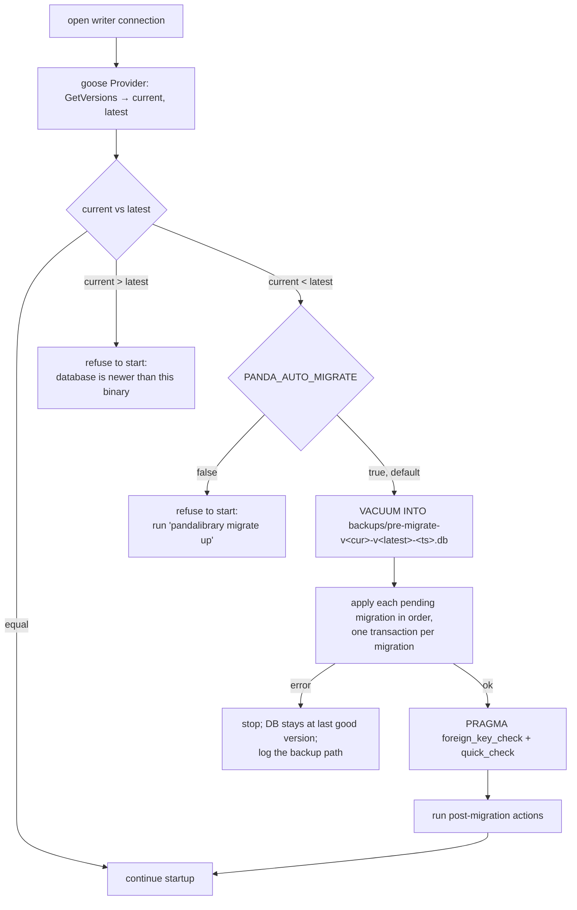

# PandaLibrary — Schema and data migrations

Decision record: [ADR-0003](../decisions/0003-auto-applied-migrations.md). Schema design:
[database.md](./database.md).

## 1. Where the schema lives

The schema is defined **only** by the migrations in `internal/db/migrations/`. The docs never
hold a copy, so they cannot drift from the real database.

```
internal/db/migrations/
├─ 00001_init.sql                 # goose SQL migration (Up + Down)
├─ 00002_<name>.sql               # later schema changes / set-based data changes
├─ 00003_<name>.go                # Go data migration (row-wise transforms needing Go logic)
├─ migrations.go                  # //go:embed *.sql; Go migration registry; Run()
├─ migrations.sum                 # sha256 of every migration file (immutability check)
└─ migrations_test.go
```

- `sqlc.yaml` points `schema:` at this folder. sqlc reads the `+goose Up` sections, so the
  generated models always match the latest migration.
- Versions are **sequential** (`00002`, `00003`, …), not timestamps. See §6 for why.

## 2. Automatic apply on startup

Every `pandalibrary serve` start runs this before the HTTP listener opens:



- "Detect a schema change" means that the binary contains migrations the database has not
  applied. goose records the applied versions in `goose_db_version`.
- A fresh, empty database takes the same path. There is no separate "create schema" code.
- The pre-migration backup is skipped for an empty database. It is kept by the normal
  backup retention.
- `pandalibrary migrate status|up|down-to <v>` exists for operators and development.
  `down-to` is meant for development only. In production you roll back by restoring the
  pre-migration backup with the previous binary.
- `/healthz` reports 503 until migrations and post-migration actions have finished.

## 3. Kinds of migration

| Kind | File | Use for | Runs |
|---|---|---|---|
| Schema | `NNNNN_name.sql` | `CREATE`/`ALTER`/`DROP`, indexes, FTS tables, table rebuilds | in a transaction, unless annotated (below) |
| Set-based data | same `.sql` file, after the DDL | Backfills expressible in SQL (`UPDATE … SET x = …`, `INSERT … SELECT`) | same transaction as the DDL |
| Go data | `NNNNN_name.go` registered with `goose.NewGoMigration` | Row-wise transforms that need Go (pinyin `sort_title`, JSON reshaping, NFKC normalization) | in a transaction, on the writer |
| Post-migration action | flag set by a migration, handled in Go after `Up` | Rebuilding FTS indexes | before the server starts serving requests |
| Background job | flag set by a migration, picked up by a worker | Slow work over files: re-hash, re-extract metadata, regenerate covers | after startup, with progress shown in the admin UI |

Rules for Go data migrations:

- **Freeze the code.** A Go migration uses raw SQL against `*sql.Tx` and copies any helper
  it needs into the migration file. It never imports `internal/db/sqlc` or service packages,
  because those change with later migrations, and the migration must still behave the same
  when run years later.
- Process rows in batches (`WHERE id > ? ORDER BY id LIMIT 1000`), all inside the migration
  transaction. SQLite handles one large write transaction for a personal library without
  trouble.
- Migrations must not make network calls or read book files. That work goes to a
  background job.

Post-migration actions and background jobs are requested through `server_settings` keys
(for example `migrate.pending.fts_rebuild = true`, `migrate.pending.reextract = ["mobi"]`).
The migration only writes the flag, and the Go code that handles it clears the flag. This
keeps migrations idempotent and lets an interrupted job resume.

## 4. Writing a migration (checklist)

1. `task migrate:new NAME=add_book_language_index`. This creates the next sequential
   `.sql` (or `TYPE=go` for a Go migration) from a template.
2. Write `+goose Up` and `+goose Down`. Down must restore the previous schema, but it may
   lose data added since the migration.
3. **Changing a CHECK, a column type or a foreign key** requires the SQLite 12-step table
   rebuild:
   - annotate the file `-- +goose NO TRANSACTION`;
   - `PRAGMA foreign_keys=OFF; BEGIN; CREATE TABLE new_x …; INSERT INTO new_x SELECT …;
     DROP TABLE x; ALTER TABLE new_x RENAME TO x;` then recreate indexes and FTS bookkeeping;
   - `PRAGMA foreign_key_check; COMMIT; PRAGMA foreign_keys=ON;`
   - the runner's `foreign_key_check` (§2) runs again afterwards.
4. If indexed text changed, set the FTS rebuild flag.
5. `task migrate:sum` adds the new file's hash to `migrations.sum`.
6. `task sqlc` regenerates the queries, and `task test` runs the migration tests (§5).
7. Update [database.md](./database.md) if the design changed (tables, indexes, rules), and
   add an ADR if the change reverses an earlier decision.

**Never edit a migration that has been merged.** Fix mistakes with a new migration. The
`migrations.sum` test fails if a merged file changes.

## 5. Tests (CI-enforced)

| Test | Checks |
|---|---|
| `TestMigrationsSum` | Every migration file is listed in `migrations.sum` with the same hash, and versions are contiguous with no duplicates |
| `TestUpFromEmpty` | All migrations apply to an empty database; `integrity_check` = ok, `foreign_key_check` empty |
| `TestUpDownUp` | Down to 0 and back up works (development safety) |
| `TestUpgradeFromEachVersion` | For each version N: migrate to N, load the fixture `testdata/vN.sql` if one exists, migrate to latest, then run the assertions in `testdata/vN_assert_test.go` (used for data migrations) |
| `TestRefuseNewerDB` | A database with a version above the binary's latest makes startup fail with the documented error |
| `TestSqlcInSync` (CI step) | `sqlc diff` reports no difference |

## 6. Why sequential versions with a single migration owner

Parallel agent sessions (see [plans](../plans/README.md)) create a risk that two branches
add `00002_*` at the same time. Timestamp versions avoid the name clash, but goose then
needs `allow-missing` to apply an older-numbered migration that merged later, and the
order would then differ between databases. Instead:

- The initial schema already covers every v1 table, so most tasks need no migration.
- A plan task that needs a migration says so in its prompt (`Owns migration: yes`). Only
  one in-flight task may own a migration at a time; the plan serializes those tasks.
- If a collision still happens, the second branch renumbers on rebase
  (`goose fix`-style rename + `task migrate:sum`). `TestMigrationsSum` fails on duplicate
  versions, so a collision cannot be merged by accident.

## 7. Configuration

| Variable | Default | Purpose |
|---|---|---|
| `PANDA_AUTO_MIGRATE` | `true` | Apply pending migrations at startup. `false` makes startup fail with an instruction to run `pandalibrary migrate up` |
| `PANDA_MIGRATE_BACKUP` | `true` | Take the pre-migration `VACUUM INTO` backup |
