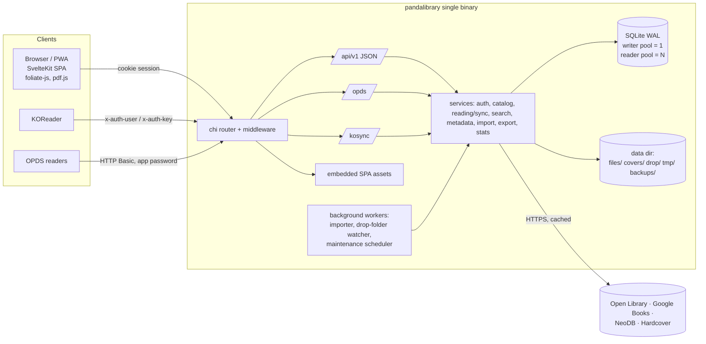

# PandaLibrary — Architecture

Status: accepted design, implementation in progress. The database design is in
[database.md](./database.md), the migration process in [migrations.md](./migrations.md),
and the initial migration in [00001_init.sql](../../internal/db/migrations/00001_init.sql).
Decisions are recorded in
[../decisions](../decisions/README.md); the task breakdown is in
[../plans](../plans/README.md). This document is self-contained so a new session can
continue from it without prior chat context.

## 1. Decided stack (summary)

| Area | Decision |
|---|---|
| Backend | Go, chi router, SQLite via pure-Go `modernc.org/sqlite` (WAL), sqlc queries, goose migrations |
| Auth | SQLite-backed sessions, HttpOnly cookies, argon2id passwords, `admin` / `user` roles |
| Device auth | Per-user app passwords, separate kinds for OPDS and KOReader sync |
| Files | Local disk, content-addressed by SHA-256 (dedupe); fsnotify drop folder auto-import |
| File metadata | EPUB OPF, PDF via pdfcpu, MOBI/AZW3 EXTH, FB2 XML, CBZ ComicInfo.xml |
| Online metadata | Open Library + Google Books (default on); NeoDB, Hardcover (on when admin adds a token); per-field pick; SQLite cache |
| Search | SQLite FTS5 trigram tokenizer (CJK substring search); LIKE fallback for < 3 characters |
| Integrations | OPDS 1.2 catalog; KOReader progress sync (cross-reader positions match by percentage) |
| Frontend | SvelteKit (Svelte 5) static SPA embedded in the binary; Tailwind v4 + shadcn-svelte; LayerChart; paraglide-js (en, zh) |
| Readers | foliate-js (EPUB, MOBI, AZW3, FB2, CBZ); pdf.js (PDF, and PDF cover rendering in the browser) |
| Notes | CodeMirror 6 Markdown editor + sanitized preview; per-book or per-highlight; Obsidian Markdown export |
| Offline | PWA: books cached on device, offline progress queued, last-write-wins on conflicts |
| Access | Libraries with per-user access; per-user per-book hide list; private + admin-shared shelves |
| Catalog | Tags; series with decimal index (1.5) |
| Per user | Reading status, rating, synced reader settings, reading sessions for stats |
| Deploy | Single static binary + small Docker image |

### Assumptions made in this design (change if wrong)

1. **A book belongs to exactly one library.** Moving a book = changing `books.library_id`.
   Duplicate detection (SHA-256) is global, so the same file cannot exist in two libraries.
2. **Catalog writes are admin-only in v1** (upload, edit metadata, delete, manage libraries,
   shared shelves, hide lists). Regular users read, and manage their own state, private
   shelves, highlights and notes. A per-user "can upload" flag can be added later.
3. **App passwords are server-generated random secrets** (≥ 80 bits), so they are stored as
   SHA-256, not argon2id. Argon2id is for human-chosen login passwords only. This keeps
   OPDS/KOReader requests (authenticated on every call) cheap.
4. **Ratings are integers 1–10, shown as half-stars** (7 = 3.5★).
5. **Searches shorter than 3 characters still work** through a `LIKE` scan (two-character
   Chinese titles such as 三体 are common). Trigram `MATCH` is used from 3 characters up.

## 2. System overview



One process handles everything. There are no external services other than the optional
metadata providers.

## 3. Repository layout

```
pandalibrary/
├─ cmd/pandalibrary/main.go       # subcommands: serve (default), migrate, healthcheck, user (create/reset-password)
├─ internal/
│  ├─ app/                        # wiring: build services, start workers, graceful shutdown
│  ├─ config/                     # env/flags → Config struct
│  ├─ db/
│  │  ├─ migrations/              # goose SQL + Go migrations, go:embed, migrations.sum (see migrations.md)
│  │  ├─ queries/                 # *.sql for sqlc, one file per area
│  │  ├─ sqlc/                    # generated code (do not edit)
│  │  └─ db.go                    # Open(writer, reader pools), WithTx, NextRev
│  ├─ auth/                       # argon2id, sessions, app passwords, login rate limiting
│  ├─ catalog/                    # libraries, access, books, authors, series, tags, shelves, hide list
│  ├─ blobstore/                  # content-addressed file + cover storage
│  ├─ importer/                   # pipeline, worker pool, drop-folder watcher
│  ├─ extract/                    # epub/, pdf/, mobi/, fb2/, cbz/ → common Metadata struct
│  ├─ covers/                     # decode, resize, encode JPEG covers + thumbnails
│  ├─ metadata/                   # provider interface, cache, openlibrary/, googlebooks/, neodb/, hardcover/
│  ├─ search/                     # FTS indexing + query building
│  ├─ reading/                    # progress, user_books, highlights, notes, settings, sessions, sync push/pull
│  ├─ kosync/                     # KOReader sync protocol adapter (uses reading/)
│  ├─ opds/                       # OPDS 1.2 Atom feeds (uses catalog/, search/)
│  ├─ stats/                      # aggregations for the dashboard
│  ├─ export/                     # Obsidian Markdown export
│  ├─ jobs/                       # maintenance scheduler (cleanup, backups, checkpoints)
│  └─ httpapi/                    # router, middleware, handlers, DTOs, error mapping
├─ web/                           # SvelteKit project
│  ├─ src/ …                      # see §12
│  ├─ messages/{en,zh}.json       # paraglide
│  ├─ build/                      # adapter-static output (git-ignored)
│  └─ embed.go                    # package webui: //go:embed all:build  (go:embed cannot use ../)
├─ docs/
│  ├─ architecture/               # system.md, database.md, migrations.md
│  ├─ decisions/                  # ADRs (NNNN-title.md)
│  ├─ plans/                      # task breakdown, dependency graph, numbered steps
│  ├─ prompts/                    # one implementation prompt per plan task
│  └─ progress/                   # task status board + change log
├─ sqlc.yaml
├─ Dockerfile
└─ Taskfile.yml (or Makefile)
```

### Layering rules

- `httpapi` → services → `db/sqlc`. Handlers never call sqlc directly.
- Services own transactions (`db.WithTx`). Slow work (file hashing, parsing, HTTP to
  providers, image resizing) happens **outside** write transactions.
- Every catalog read takes a `Viewer{UserID, IsAdmin}` and applies the visibility predicate
  (database.md §5). This includes search, OPDS, shelves, stats, export and file download.
- `kosync` and `opds` are protocol adapters only; all rules live in `reading` / `catalog`.

## 4. Runtime and data directory

```
$PANDA_DATA_DIR (default /data)
├─ pandalibrary.db, -wal, -shm
├─ files/ab/<sha256>.<ext>        # immutable book files
├─ covers/ab/<sha256>.jpg         # normalized cover (max 1200 px), sha256 of the output bytes
├─ covers/ab/<sha256>-w400.jpg    # thumbnail
├─ drop/                          # watched; drop/<library-slug>/… targets a specific library
│  ├─ .duplicates/  .failed/      # ignored by the watcher
├─ tmp/                           # same filesystem as files/ so the final move is an atomic rename
└─ backups/                       # VACUUM INTO snapshots
```

Configuration is via environment variables (flags mirror them):

| Variable | Default | Purpose |
|---|---|---|
| `PANDA_DATA_DIR` | `/data` | Root of everything above |
| `PANDA_LISTEN` | `:8080` | HTTP listen address |
| `PANDA_BASE_URL` | — | Public URL; used for OPDS absolute links, Secure cookies, Origin checks |
| `PANDA_DROP_DIR` | `$DATA/drop` | Watched import folder |
| `PANDA_DROP_POLL` | `0` (off) | Polling interval fallback for NFS/SMB mounts where fsnotify is unreliable |
| `PANDA_TRUSTED_PROXIES` | — | CIDRs allowed to set X-Forwarded-For / -Proto |
| `PANDA_MAX_UPLOAD_MB` | `1024` | Upload size limit |
| `PANDA_LOG_LEVEL` | `info` | slog level |
| `PANDA_AUTO_MIGRATE` | `true` | Apply pending migrations at startup ([migrations.md](./migrations.md)) |
| `PANDA_MIGRATE_BACKUP` | `true` | `VACUUM INTO` backup before applying migrations |

Background goroutines (all stop on context cancel during graceful shutdown):

| Worker | Schedule | Work |
|---|---|---|
| Importer pool (2 workers) | queue | Process `import_jobs` (resumes `pending`/`processing` rows on startup) |
| Drop-folder watcher | fsnotify (+ optional poll) | Debounce until file is stable, enqueue job |
| Maintenance | hourly | Delete expired sessions; prune expired `metadata_cache` rows; prune `import_jobs` > 30 days |
| Maintenance | daily | `VACUUM INTO backups/…` (keep N); orphan blob sweep; `PRAGMA optimize` |
| Maintenance | every 5 min | `PRAGMA wal_checkpoint(PASSIVE)` |

### SQLite connections

Two `*sql.DB` handles on the same file:

- **Writer**: `MaxOpenConns=1`, DSN `_txlock=immediate`, so write transactions take the lock
  up front and never hit an upgrade deadlock.
- **Reader**: `MaxOpenConns=max(4, NumCPU)`, `_pragma=query_only(1)`.

Per-connection pragmas through the DSN: `journal_mode(WAL)`, `synchronous(NORMAL)`,
`foreign_keys(1)`, `busy_timeout(10000)`, `temp_store(MEMORY)`, `cache_size(-32000)`.
Verified with modernc.org/sqlite v1.61.1 (SQLite 3.54.1).

## 5. HTTP surface

All JSON APIs are under `/api/v1`. Errors are `application/problem+json`. List endpoints use
keyset cursors (`?cursor=…&limit=…`).

| Prefix | Auth | Purpose |
|---|---|---|
| `/api/v1/auth/*` | none / session | `POST login`, `POST logout`, `GET me` |
| `/api/v1/setup` | none / setup token | `GET` first-run status; `POST` creates the first admin only while `users` is empty |
| `/api/v1/libraries`, `/books`, `/authors`, `/series`, `/tags`, `/shelves` | session | Catalog browse/filter/sort; writes admin-only (shelves: owner or admin) |
| `/api/v1/books/{id}/files/{fileId}` | session | Stream the file (Range and SHA-256 ETag; immutable caching only for hash-versioned URLs) |
| `/api/v1/books/{id}/cover?w=400` | session | Cover/thumbnail; `PUT` uploads a cover (admin; pdf.js-rendered PDF covers) |
| `/api/v1/uploads` | admin | Multipart streaming upload → import job; `POST /books/{id}/files` adds a format |
| `/api/v1/imports` | admin | Import job list/status |
| `/api/v1/books/{id}/metadata/candidates` | admin | Fan out to enabled providers (cached) |
| `/api/v1/books/{id}/metadata/apply` | admin | Apply per-field choices `{field: {source, ref, value}}` |
| `/api/v1/search?q=` | session | Books; `/api/v1/search/annotations?q=` for the user's own highlights/notes |
| `/api/v1/me/books/{id}` | session | Status, rating, progress, highlights, notes |
| `/api/v1/sync/pull`, `/api/v1/sync/push` | session | PWA offline sync (§10) |
| `/api/v1/me/profile` | session | Read/update the current user's display name and locale |
| `/api/v1/me/app-passwords` | session | Create (secret shown once), list, revoke |
| `/api/v1/me/settings` | session | Synced reader/UI settings |
| `/api/v1/stats/*` | session | Dashboard aggregates |
| `/api/v1/export/notes` | session | Markdown (one book) or zip (many) |
| `/api/v1/admin/*` | admin | Users, libraries, access grants, hide list, providers, backups, reindex |
| `/opds/*` | Basic (opds app password) | OPDS 1.2 (§9) |
| `/kosync/*` | KOReader headers (kosync app password) | KOReader sync (§8) |
| `/healthz` | none | Liveness (DB ping) |
| everything else | none | Embedded SPA; unknown paths → `index.html`; `/_app/immutable/*` cached for 1 year |

### Catalog contract (C1)

C1 implements the library, book, author, series, tag, file, cover, and library-access /
hide-list routes above; the other domains remain later tasks. Lists return
`{"items":[...],"next_cursor":"..."}` with `next_cursor: null` at the end. The default
page size is 50, the maximum is 100, and cursors are bound to the viewer, list, sort and
filters. Book filters are `library_id`, `author_id`, `series_id`, and `tag_id`; `sort`
is `title` (default), `added`, or `series` (requires `series_id`). Title is ordered by
`(sort_title, id)`, added by `(created_at, id)` descending, and series by index
ascending, nulls last, then ID. Invalid or mismatched cursors and filters return 400.

Single responses use named objects such as `{"book":{...}}` or `{"library":{...}}`.
Timestamps are UTC RFC 3339 strings. Libraries expose `id`, `name`, `slug`,
`created_at`, and `updated_at`. Authors, series, and tags expose `id`, `name`, and
`visible_book_count`; a series description is included when present.

Books expose `id`, `library_id`, `title`, `sort_title`, nullable `subtitle`,
`description`, `language`, `publisher`, `published_date`, `page_count`, `cover_url`,
`cover_source`, and `series`, plus `created_at` and `updated_at`. Their `authors`,
`tags`, `identifiers`, `files`, and `field_sources` are arrays even when empty:

- Authors contain `id`, `name`, `role`, and `position`; series contains `id`, `name`,
  and nullable `index`; tags contain `id` and `name`; identifiers contain `scheme` and
  `value`.
- Files contain `id`, `format`, `size_bytes`, and `download_url` with `?v=<sha256>`.
  Field sources contain `field`, `source`, nullable `source_ref` and `chosen_by`, and
  `chosen_at`.

All book-derived reads, including entity counts and media, apply the predicate in
[database.md §5](./database.md#5-visibility-predicate-must-appear-in-every-catalog-read):
admins bypass library grants, not their own hide list. Invisible and nonexistent books
both return 404. Admin-only ACL lists expose IDs and grant/hide metadata, not book
metadata, so an admin can remove their own hide entry. Library and ACL mutations and
book PATCH/DELETE are admin-only and return JSON; unsafe session requests require
cookie-origin protection. Book PATCH distinguishes absent fields from nulls, replaces
supplied association arrays, records manual provenance, and updates FTS transactionally.

Bare file URLs and cover URLs use `private, no-cache`, `Vary: Cookie`, and strong ETags;
they omit date validators because an ID can be reused or a cover replaced within the
same second. Only a file URL whose `v` matches the current SHA-256 uses private immutable
caching. File and cover reads authorize before returning content or 304. Covers support
full JPEG and `?w=400` variants; admin PUT accepts a raw JPEG/PNG/GIF/WebP body up to
20 MiB and optional `source=upload|pdfjs`.

For downstream domains, construct a trusted `catalog.Viewer` from authentication and
reuse `catalog.Service` reads and `CheckVisible`; do not derive identity from request
parameters. I1 can reuse `catalog.SortTitle` and `blobstore.BookPath`, and call
`search.IndexBook` within its own write transaction after updating metadata. S1 and other
new book-derived queries must apply the same SQL predicate and extend the visibility
test harness. Blob cleanup and general book-file publication remain I1/J1 work.

Middleware order: request ID → structured logging (slog) → panic recovery → real IP (only from
trusted proxies) → security headers → body size limit → `http.CrossOriginProtection`
(Go 1.25+, unsafe methods on cookie routes) → auth (per route group) → rate limit (login,
setup, kosync/opds auth failures).

## 6. Authentication and security

**Passwords:** argon2id with RFC 9106 second recommended parameters (t=3, m=64 MiB, p=4,
16-byte salt, 32-byte key), PHC string. Rehash on login when the parameters change. A
semaphore of 2 limits concurrent hashing, since each hash uses 64 MiB. Unknown usernames
still run a dummy Argon2id hash so response timing does not reveal which usernames exist.
Passwords must contain at least 12 UTF-8 bytes and may not exceed 1024 bytes.

**Sessions:** 32 random bytes in base64url, stored in the cookie `pl_session`; the database
keeps only `sha256(token)`. The cookie is `HttpOnly`, `SameSite=Lax`, `Path=/` and `Secure`
when the base URL is https. Sessions last 30 days and slide forward, with
`last_seen_at`/`expires_at` written at most once per hour. Disabling a user or changing
their password deletes their sessions.

**App passwords:** 16 characters from a 32-symbol unambiguous alphabet (80 bits), shown as
`xxxx-xxxx-xxxx-xxxx` so it is easy to type on an e-reader. The secret is shown once, has a
label and records `last_used_at`. The lookup is by the hash, which is unique, followed by a
check that the username matches. `kind` keeps OPDS and KOReader credentials separate.

**First run:** while `users` is empty, the server logs a random 32-byte base64url setup
token and `POST /api/v1/setup` requires it. The token is invalidated on restart; successful
setup creates an administrator and a browser session. `GET /api/v1/setup` reports whether
setup is still required. `pandalibrary user create --username <name> --admin` is the CLI
alternative; `user reset-password --username <name>` replaces a password and revokes
sessions. Both commands prompt for passwords without echo.

**Rate limits:** login and setup allow five attempts per resolved client IP in a
10-minute window. The in-memory limiter has a bounded 4096-client table and returns 429
when a client exceeds the limit.

**Untrusted content:**

- *SPA CSP:* `default-src 'self'; script-src 'self' 'wasm-unsafe-eval' 'nonce-<per-response>'; style-src 'self' 'unsafe-inline'; img-src 'self' blob: data:; font-src 'self' blob: data:; media-src 'self' blob:; connect-src 'self'; worker-src 'self' blob:; frame-src 'self' blob:; object-src 'none'; base-uri 'self'; frame-ancestors 'none'`.
  The embedded SvelteKit fallback has an inline bootstrap script. The server assigns a
  fresh nonce to its script tags and CSP on every response, with `Cache-Control: no-store`;
  other responses omit the nonce. This permits the bootstrap without allowing arbitrary
  inline scripts.
  foliate-js renders book sections in `blob:` iframes, which inherit this CSP, so scripts
  inside EPUBs are blocked. Verify this during the reader milestone.
- *Notes and descriptions:* Markdown is rendered to HTML in the browser and passed through
  DOMPurify before insertion. Provider and file descriptions get the same sanitizer. OPDS
  output is XML-escaped.
- *Book files:* served with their real `Content-Type`, `X-Content-Type-Options: nosniff`,
  and never as `text/html`.
- *Archive parsing:* limits on entry count, per-entry size and total uncompressed size. Paths
  inside archives are never used as disk paths. Every extractor runs with a timeout and
  `recover`.
- *XML:* Go's `encoding/xml` does not resolve external entities, so XXE is not possible.
- *SSRF:* the server downloads provider covers only from URLs found in its own cached
  provider responses, and only from an allowlist of hosts per provider. The client never
  supplies a URL.

**Authorization:** admins can do everything. A user sees a book only if they have access to
its library and it is not on their hide list. Users can write only their own reading data,
their private shelves, and app passwords.

## 7. Import pipeline

```mermaid
sequenceDiagram
  participant S as Source (upload / drop folder)
  participant I as Importer worker
  participant FS as Disk
  participant DB as SQLite
  S->>I: enqueue import_jobs(pending)
  I->>FS: stream to tmp/ while hashing (sha256, size, KOReader partial MD5)
  I->>DB: SELECT book_files WHERE sha256=? (reader)
  alt duplicate
    I->>DB: job → duplicate (duplicate_of_book_id)
    I->>FS: delete tmp / move drop file to drop/.duplicates/
  else new
    I->>I: sniff format (magic bytes), extract metadata + cover (timeout, recover)
    I->>FS: write cover; rename tmp → files/ab/<sha>.<ext>
    I->>DB: one write tx: book, authors, series, tags, identifiers, book_files, field_sources('file'), books_fts, job → imported
    I->>FS: delete drop source (drop folder only)
  end
```

- **Format sniffing:**
  - EPUB: ZIP whose `mimetype` entry is `application/epub+zip`.
  - PDF: starts with `%PDF-`.
  - MOBI/AZW3: `BOOKMOBI` at offset 60; KF8 (MOBI header version 8 or a KF8 boundary) means AZW3.
  - FB2: XML root `FictionBook`.
  - FBZ: ZIP containing a `.fb2`.
  - CBZ: ZIP whose entries are images.
- **Crash safety:** the blob is written before its database row. The daily orphan sweep
  deletes blobs with no row that are older than one hour. If a row exists but its blob is
  missing, the admin integrity report shows it.
- **Drop folder:**
  - fsnotify does not watch subfolders on its own, so the watcher adds a watch for `drop/`
    and for each `drop/<library-slug>/`. Files at the root go to the default library
    (`server_settings.default_library_id`).
  - Ignored: hidden files and folders, `*.part`, `*.crdownload`, `*.tmp`.
  - A file is processed once its size and mtime have been stable for 3 s.
  - A full scan runs at startup (to catch events missed while down), and on
    `PANDA_DROP_POLL` if set.
  - Results: on success the source is deleted. Duplicates move to `.duplicates/`. Failures
    move to `.failed/` with a `<name>.error.txt`.
- **sort_title:** lowercase; leading English articles ("the ", "a ", "an ") are moved to the
  end; Han characters are converted to toneless pinyin (e.g. `mozillazg/go-pinyin`) so
  Chinese and Latin titles sort together.

### Per-format extraction (server side → common `extract.Metadata`)

| Format | Source | Fields |
|---|---|---|
| EPUB | `META-INF/container.xml` → OPF | `dc:title`, `dc:creator` (role, file-as, EPUB3 `refines`), language, publisher, date, description, identifiers (ISBN detection), subjects → tags, series from `calibre:series`/`calibre:series_index` or EPUB3 `belongs-to-collection` + `group-position`; cover from `properties="cover-image"`, else `<meta name="cover">`, else guide cover |
| PDF | pdfcpu | Info dict (Title, Author, Subject, Keywords), page count. **Cover is rendered by pdf.js in the browser** and uploaded (admin UI has a "generate missing PDF covers" batch action) |
| MOBI/AZW3 | PDB → MOBI header → EXTH (small in-house parser) | 503 title, 100 author, 101 publisher, 103 description, 104 ISBN, 105 subject, 106 date, 524 language; cover from EXTH 201 (image record offset) |
| FB2 / FBZ | `encoding/xml` streaming, `CharsetReader` from `x/net/html/charset` (windows-1251 is common) | `title-info` (book-title, author names, genre, lang, `sequence` name/number → series, annotation), `publish-info` (publisher, year, isbn), `coverpage` → base64 `<binary>` |
| CBZ | `ComicInfo.xml` | Title, Series, Number (decimal), Writer, Summary, Year/Month/Day, Publisher, LanguageISO, Genre/Tags, PageCount; cover = `Pages/Page[@Type='FrontCover']` or first image in natural sort order |

If a field is missing, the title falls back to the cleaned filename. Covers are normalized
by `covers/`, which decodes JPEG/PNG/GIF/WebP, resizes to at most 1200 px plus a 400 px
thumbnail, and encodes JPEG.

## 8. KOReader sync (`/kosync`)

Implements the kosync protocol that KOReader's sync plugin speaks. The user sets a custom
server URL of `https://host/kosync`, uses their username, and enters a **kosync app
password** as the password.

| Endpoint | Behaviour |
|---|---|
| `POST /kosync/users/create` | Always refused (accounts are made in the web UI) |
| `GET /kosync/users/auth` | 200 if `x-auth-user` + `x-auth-key` are valid |
| `PUT /kosync/syncs/progress` | Body `{document, progress, percentage, device, device_id}` |
| `GET /kosync/syncs/progress/{document}` | Returns `{document, progress, percentage, device, device_id, timestamp}` |
| `GET /kosync/healthcheck` | `{"state":"OK"}` |

**Auth:** KOReader sends `x-auth-key = md5(password)`. The server computes
`sha256(x-auth-key)`, looks up `app_passwords` by that hash with `kind='kosync'`, and checks
the username.

**Document identity:** KOReader's default "Binary" checksum is a partial MD5 of 1024-byte
samples at offsets `1024 << (2*i)` for i = -1…10. In LuaJIT, i = -1 gives offset 0. Reading
stops at EOF. The importer computes this as `book_files.koreader_md5`. KOReader's
"Filename" checksum method cannot be mapped to a book; those documents still sync between
KOReader devices through `kosync_progress`, but not with the web reader.
**Consequence: files must be served byte-for-byte as stored.** Never rewrite metadata into
files on download, because that would change the digest.

**PUT:**

1. Upsert the raw `kosync_progress` row.
2. If the digest maps to a `book_file` the user can see, apply the same change to
   `reading_progress` with LWW: `source='koreader'`, the locator is `{"xpointer": …}` (or
   `{"page": n}` for PDF/CBZ), and `updated_at` is now.
3. Extend or create a server-derived `reading_sessions` row (`source='koreader'`):
   - a push within 15 min of the previous push from the same device extends the session;
   - otherwise a new session starts.

**GET:** KOReader jumps using `progress`, not `percentage`. It calls
`GotoXPointer(progress)` for reflowable books and `GotoPage(tonumber(progress))` for paged
ones. So:

- If the raw row is at least as new as `reading_progress`, return it unchanged. This keeps
  KOReader↔KOReader sync exact.
- If the web reader is newer, synthesize a response from the web position:
  - PDF and CBZ (paged): `progress = page number` (exact).
  - EPUB, FB2, MOBI and AZW3 (reflowable): `progress = "/body/DocFragment[<spine+1>]/body"`,
    which lands at the start of the current chapter.
  - In both cases: `percentage` is the web value, `device = "PandaLibrary Web"`, and
    `timestamp = updated_at/1000`.
  - **Risk to validate early:** confirm that KOReader accepts the DocFragment-level
    XPointer. If it does not, return the last KOReader XPointer, so the user sees the
    "newer progress at N%" prompt and can jump manually.

Web reader opening a book: if the latest progress is from the same file and source, it jumps
to the exact locator; otherwise it calls foliate's `goToFraction(percentage)` or goes to the
PDF page `ceil(percentage × pages)`.

## 9. OPDS 1.2 (`/opds`)

HTTP Basic auth with username + **opds app password**. The feeds are Atom; navigation feeds
use `kind=navigation`. Acquisition links point to `/opds/books/{id}/files/{fileId}`, which
uses the same handler as the API download.

- `/opds` root → Recently added, Libraries, Authors, Series, Tags, Shelves (own + shared),
  Reading now, Want to read
- Paged acquisition feeds (`rel="next"`, 50 per page), with covers and thumbnails
  (`http://opds-spec.org/image`, `…/image/thumbnail`)
- Search through an OpenSearch description at `/opds/opensearch.xml`, using the same
  search service (including the < 3 character fallback)
- Every feed applies the visibility predicate
- OPDS-PSE page streaming for CBZ is a possible later addition

## 10. PWA offline sync (`/api/v1/sync`)

**Synced entities:** `reading_progress`, `user_books`, `highlights`, `notes`,
`user_settings`. `reading_sessions` are upload-only.

**Push:**

1. The client keeps an **outbox** in IndexedDB. Each mutation is
   `{entity, id/key, op: upsert|delete, data, updated_at}`.
2. `POST /sync/push` sends up to 500 mutations.
3. For each mutation the server, in one write transaction:
   1. checks ownership and that the book is visible;
   2. clamps `updated_at` to `min(client_ts, server_now)`, so a device whose clock is
      ahead cannot win forever;
   3. takes `rev = NextRev()`;
   4. runs `INSERT … ON CONFLICT DO UPDATE … WHERE excluded.updated_at > current.updated_at`
      (database.md §6).
4. The response gives each item a result: `applied`, `stale` or `rejected`. Mutations are
   idempotent: client UUIDv7 ids for highlights, notes and sessions; natural keys for the
   rest.

**Pull:** `GET /sync/pull?cursor=N` runs in one read transaction, so it sees a consistent
WAL snapshot.

1. Read `hi = sync_counter.value`.
2. Return this user's rows with `N < rev ≤ hi` from each synced table, including
   tombstones (`deleted_at`).
3. Return `cursor = hi`.

Rev gaps can occur, for example when a write loses LWW, but they are harmless. Because there
is a single writer, a smaller rev can never commit after a larger one.

**When it runs:** the client pushes and then pulls on app start, on `online`, on
`visibilitychange` → visible, every 60 s while a reader is open, and on Background Sync
where supported.

**Conflicts:** last-write-wins per row on `updated_at`. Deletes are tombstones with
`updated_at` too, so an older edit cannot bring a deleted highlight back. Deleting a
highlight also tombstones the notes attached to it, in the same transaction.

**Offline books:**

- The user clicks "Download for offline".
- The SPA stores the file response in Cache Storage (`books-v1`, keyed by the file URL),
  stores the book's detail JSON and cover in IndexedDB, and calls
  `navigator.storage.persist()`.
- Readers open from a `Blob`, whether it came from the cache or the network.
- Settings show storage usage and an evict action.
- If the server later returns 403/404 for that book, the cached copy is evicted.
- iOS Safari has no Background Sync and may evict storage, so sync runs on app open.

## 11. Online metadata

```go
type Provider interface {
    Name() string                                            // "openlibrary", ...
    Search(ctx context.Context, q Query) ([]Candidate, error) // q: ISBN or title/author/lang
    Get(ctx context.Context, ref string) (*Candidate, error)
}
```

- `Candidate` is a normalized struct: title, subtitle, people with roles, description,
  publisher, date, language, page count, series and index, tags, identifiers, cover URL.
  It is cached as JSON in `metadata_cache` with a `schema_version`.
- **Lookup:** ISBN first, otherwise title + first author. Enabled providers are queried in
  parallel, with an 8 s timeout and a token-bucket rate limit for each.
- **Cache TTL:** hit = 30 days, not found = 7 days, error = 10 minutes.
- **Providers:**
  - Open Library: sends a descriptive `User-Agent` with contact info, as Open Library asks.
  - Google Books: optional API key in `api_token`.
  - NeoDB: `base_url` configurable (default `https://neodb.social`, a federated
    instance) with a Bearer token.
  - Hardcover: GraphQL with a Bearer token.
  - Exact endpoint paths are pinned during implementation against current API docs.
- **Edit UI:** a grid with one row per field and columns for *Current / File / provider
  results*.
  - The admin picks a source for each field with a radio button, or types a value.
  - `apply` writes the values and records `book_field_sources`.
  - A provider cover is downloaded by the server using the URL from the cached candidate
    (allowlisted host), then normalized.

## 12. Frontend

- **App shell:**
  - SvelteKit with `adapter-static`, `fallback: 'index.html'`, `ssr = false`.
  - Vite dev server proxies `/api`, `/opds` and `/kosync` to Go on `:8080`.
  - The build output `web/build` is embedded by `web/embed.go`.
- **State:** Svelte 5 runes in small store classes (`session`, `library`, `sync`). The API
  client is a typed `fetch` wrapper; TypeScript DTOs mirror the Go DTOs, and OpenAPI
  generation can come later.
- **Routes:**
  - `login`, `setup`
  - `library/[id]` (grid/list, filters: author, series, tag, status, shelf; sort)
  - `books/[id]`, `books/[id]/edit` (metadata merge grid)
  - `read/[bookId]/[fileId]`
  - `shelves/[id]`, `series/[id]`, `authors/[id]`, `tags/[name]`
  - `notes` (all of the user's notes and highlights, searchable)
  - `stats`
  - `settings` (profile, devices/app passwords, reader defaults, offline storage)
  - `admin/*` (users, libraries & access, hide list, providers, imports, maintenance)
- **Readers:** a common `Reader` interface (`open(blob)`, `goTo(locator | fraction)`,
  `relocate` events with `{fraction, locator}`, annotation add/remove/render) with two
  adapters:
  - foliate-js `<foliate-view>`: CFI locators, section index for the KOReader mapping,
    overlayer for highlights.
  - pdf.js (`pdfjs-dist`): page locators; the text layer for selection; highlight rects
    stored normalized to 0–1.
  - Reader settings (font, size, spacing, theme, flow) are saved to `user_settings` under
    `reader.<format>`, with optional per-book overrides at `reader.book.<id>`.
- **Reading sessions:**
  - The reader opens a session on open/visible and closes it on hide/close or after
    5 minutes idle.
  - `active_seconds` excludes idle time.
  - Sessions shorter than 30 s are dropped.
  - Sessions are queued in the outbox.
- **Notes:** a CodeMirror 6 editor with Markdown mode and a preview pane. Preview and
  read-only views go through a Markdown renderer (e.g. `marked`) and then `DOMPurify`.
- **Stats (LayerChart):** daily reading time, calendar heatmap, streaks, books finished per
  month, time per book.
  - The server returns sessions for the requested range and buckets them by day in Go
    using the user's IANA timezone, which handles DST correctly. The binary imports
    `time/tzdata`.
- **i18n:** paraglide-js with `messages/en.json` and `messages/zh.json`. The locale comes
  from `users.locale`, with the browser language as fallback.
- **Service worker** (`src/service-worker.ts`):
  - Precaches the build assets.
  - API GETs are network-first, falling back to the cache for viewed pages.
  - Book files are served cache-first, but only if the user downloaded them.
  - Uses the Background Sync tag `pl-outbox`.

## 13. Notes export (Obsidian)

The server generates the export in Go, since bodies are already Markdown. A request for one
book returns `<Title> - <Author>.md`; a request for several returns a zip.

```markdown
---
title: "三体"
author: ["刘慈欣"]
series: "地球往事"
series_index: 1
isbn: "9787536692930"
tags: [pandalibrary, sci-fi]
pandalibrary_id: 42
exported: 2026-11-02
---
# 三体

## Notes
<book-level notes, newest first>

## Highlights
> 给岁月以文明，而不是给文明以岁月。 ^hl-0190f5c2
<attached note body>
```

- Highlights are ordered by `highlights.position`.
- Block ids (`^hl-…`) allow Obsidian links into a highlight.
- File names are sanitized for Windows, macOS and Linux.

## 14. Build and deployment

- **Build:** `task build` runs `pnpm -C web build`, then `sqlc generate` (check that it
  produces no diff), then `go build -trimpath -ldflags "-s -w -X main.version=…"` with
  `CGO_ENABLED=0`.
  - Cross-compiling works because modernc is pure Go.
- **Docker** (multi-stage):
  1. `node:<lts>-alpine` builds `web/build`.
  2. `golang:<ver>-alpine` builds the static binary.
  3. Final stage `FROM scratch` with CA certificates, the binary, `USER 65532:65532`,
     `VOLUME /data`, `EXPOSE 8080`, and `HEALTHCHECK CMD ["/pandalibrary","healthcheck"]`.
     The healthcheck is a subcommand because scratch has no curl.
  - Expected image size is about 25–35 MB.
- **Backups:** the daily `VACUUM INTO` gives a consistent online copy of the database.
  `files/` and `covers/` are immutable and content-addressed, which suits rsync or restic.
- **Upgrades:** on every start the server compares the database version with the
  migrations embedded in the binary. Pending schema and data migrations are applied
  automatically on the writer connection, after a pre-migration `VACUUM INTO` backup. A
  database newer than the binary refuses to start. Details: [migrations.md](./migrations.md).
- **Reverse proxy:** sits in front for TLS. Set `PANDA_BASE_URL` and
  `PANDA_TRUSTED_PROXIES`.

## 15. Testing strategy

- **Go unit tests per package:**
  - extractors use small fixture files: EPUB2/3, PDF, MOBI, AZW3, FB2 (UTF-8 and
    cp1251), FBZ, CBZ;
  - KOReader partial MD5 against a value computed by KOReader;
  - argon2id round-trip;
  - LWW merge rules;
  - search query building, including escaping and the < 3 character path.
- **Database tests:** a temp-file database with migrations applied, testing services
  against real SQLite. The visibility predicate gets a table-driven test that covers every
  catalog query.
- **HTTP tests:** `httptest` for the auth flows, OPDS feeds (validated against the OPDS
  1.2 schema), and the kosync protocol (golden request/response pairs).
- **Frontend:** Vitest for sync, outbox and locator logic; Playwright for login, upload,
  open/read/highlight, offline progress → reconnect → sync.
- **CI:** `go vet`, `staticcheck`, `go test -race` (pure Go, no cgo needed), `sqlc diff`,
  `pnpm check`, `pnpm test`, plus the Docker build.

## 16. Risks / open items

| Item | Mitigation |
|---|---|
| Web→KOReader position on reflowable formats | Chapter-level XPointer; validate on a real device in the KOReader milestone (§8) |
| sqlc SQLite parser limits | Verified: `FROM books_fts(?)` (not `WHERE books_fts MATCH ?`); build LIKE patterns in Go; wrap `LIKE … ESCAPE` terms in parentheses; `CAST` untyped args (database.md §7) |
| fsnotify on network mounts | `PANDA_DROP_POLL` polling fallback + startup scan |
| MOBI/AZW3 rendering in foliate-js for DRM'd files | DRM files are rejected at import with a clear error (EXTH/encryption flag) |
| Large PDFs on mobile | pdf.js range requests (server supports Range); offline download is explicit |
| Argon2 memory under load | Hashing semaphore; login rate limit |

## 17. Next steps

The implementation is broken into tasks with dependencies, grouped into numbered steps, in
[plans/implementation-plan.md](../plans/implementation-plan.md). Status is tracked in
[progress](../progress/README.md).
