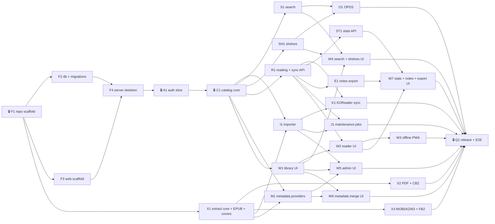

# v1 implementation plan

Status: **Accepted**. Decisions behind it: [open-questions.md](./open-questions.md) (resolved).

Design: [architecture/system.md](../architecture/system.md),
[database.md](../architecture/database.md), [migrations.md](../architecture/migrations.md).
Workflow: [ADR-0004](../decisions/0004-docs-structure-and-agent-workflow.md).

## 1. How to read this plan

- The work is split into **numbered steps** (§3). Do the steps in order.
- **Inside a step**, every task can run at the same time, one **agent session** per task,
  each on its own branch and worktree. No step has more than **4** tasks.
- **A step starts only when every task of the previous step is merged to `master`.** By
  construction, every task's dependencies are in earlier steps.
- A step marked 🔒 is a **serial gate**: one foundational task that everything after it
  needs, so run it alone. The gates are F1, F4, A1, C1 and Q1.
- For each step: ask for the prompts of its tasks → review them → start one session per
  prompt → merge all → go to the next step.
- **Owns**: paths the task may create or change freely. Anything else may change only
  through the shared-file rules in §4.
- **Migration**: whether the task may add a file to `internal/db/migrations/`. At most one
  task with `Migration: yes` may be in flight at a time ([migrations.md](../architecture/migrations.md) §6).
  The initial schema covers all v1 tables, so the expected answer is "no" for every task
  after F2.

Critical path: **F1 → F2 → F4 → A1 → C1 → R1 → W2 → W3 → Q1**.

## 2. Dependency graph

## 3. Steps

Run the steps in order. Tasks in the same row run in parallel, one agent session each.

| Step | Run | Tasks | Needs (from earlier steps) |
|---|---|---|---|
| 1 | 🔒 alone | F1 repo scaffold | — |
| 2 | 3 parallel | F2 db + migrations · F3 web scaffold · X1 extraction core + EPUB | F1 |
| 3 | 🔒 alone | F4 server skeleton | F2, F3 |
| 4 | 🔒 alone | A1 auth slice | F4 |
| 5 | 🔒 alone | C1 catalog core | A1 |
| 6 | 4 parallel | R1 reading + sync API · W1 library UI · X2 PDF + CBZ · X3 MOBI/AZW3 + FB2 | R1/W1: C1 · X2/X3: X1 |
| 7 | 4 parallel | W2 reader UI · I1 importer · S1 search · SH1 shelves | W2: R1, W1 · I1: C1, X1 · S1/SH1: C1 |
| 8 | 4 parallel | W3 offline PWA · K1 KOReader sync · M1 metadata providers · J1 maintenance jobs | W3: W2 · K1: R1, I1 · M1: C1, X1 · J1: I1, R1 |
| 9 | 4 parallel | ST1 stats API · E1 notes export · O1 OPDS · W4 search + shelves UI | ST1/E1: R1 · O1: S1, SH1 · W4: S1, SH1, W1 |
| 10 | 3 parallel | W7 stats/notes/export UI · W5 admin UI · W6 metadata merge UI | W7: ST1, E1, W2 · W5: I1, M1, W1, J1 · W6: M1, W1 |
| 11 | 🔒 alone | Q1 release + E2E | everything |

Sessions per step: 1 → 3 → 1 → 1 → 1 → 4 → 4 → 4 → 4 → 3 → 1. X2 and X3 only need X1,
but they run in step 6 so that every book format can be imported before the reader UI
(W2) and the PDF cover batch (W6) are built and tested. Critical-path tasks are
listed first in each row; if you run only 3 sessions, start those and run the fourth task
when a session frees up (it still has to finish before the next step).

## 4. Rules for parallel sessions

1. **One branch and worktree per task:**
   `git worktree add ..\pandalibrary-<id> -b task/<id>` from an up-to-date `master`.
2. **Stay inside Owns.** Changing another task's code needs a note in
   `progress/README.md` and a check that the owning task is merged or not in flight.
3. **Shared files are append-only.** Add your lines; never reorder or reformat existing
   ones. If they conflict, keep both sides.

   | Shared file | Convention |
   |---|---|
   | `internal/httpapi/routes.go` | One `Mount…` line per domain package |
   | `internal/app/app.go` | One constructor block per service |
   | `web/messages/{en,zh}.json` | Keys prefixed by area (`library.*`, `reader.*`); union on conflict |
   | `web/src/lib/nav.ts` | One entry per top-level page |
   | `go.mod` / `go.sum` | On conflict take both, then `go mod tidy` |
   | `web/pnpm-lock.yaml` | On conflict take `master`'s, then `pnpm install` |
   | `docs/progress/README.md` | Edit only your task's row; append to the log |

4. **sqlc:** each area has its own `internal/db/queries/<area>.sql`. Generated
   `<area>.sql.go` files never conflict. `models.go` changes only with a migration.
5. **Merge order inside a step** does not matter. The second branch rebases, re-runs
   `task sqlc` and `task test`, and then merges.
6. **Definition of done (every task):** `task lint test` passes; new behaviour has tests;
   the prompt's acceptance criteria are met; `progress/README.md` is updated; the
   architecture docs are updated, or an ADR added, if the design changed.

## 5. Tasks

Each task gets a prompt file `prompts/<id>-<slug>.md`, written just before it starts.

### Step 1 — alone

**F1 🔒 Repository scaffold** — deps: none — Migration: no
- Owns: `go.mod`, `cmd/pandalibrary/` (subcommand stubs), `Taskfile.yml`, `.gitignore`,
  `.editorconfig`, lint config (`staticcheck`, `go vet`), `.github/workflows/ci.yml`
  (Go job only), empty package dirs with `doc.go` per [system.md](../architecture/system.md) §3.
- Done when: `task build`, `task lint` and `task test` run green on an empty skeleton, and
  CI passes.

### Step 2 — 3 in parallel

**F2 Database and migration runner** — deps: F1 — Migration: yes (adds `migrations.sum`
and tooling; no new schema)
- Owns: `internal/db/**`, `sqlc.yaml`, `Taskfile` targets `migrate:*` and `sqlc`.
- Builds: writer and reader pools with pragmas; `WithTx`; `NextRev`; the goose Provider
  runner with startup auto-apply, pre-migration backup, newer-DB refusal, Go-migration
  registry, post-migration flag handling; the `migrate status|up|down-to` command; all
  tests in [migrations.md](../architecture/migrations.md) §5.
- Done when: an empty data dir starts at the latest version; a fake `00002` (test only)
  is applied automatically with a backup; a DB at version 99 refuses to start.

**F3 Web scaffold** — deps: F1 — Migration: no
- Owns: `web/**` (except later feature routes), CI web job.
- Builds: SvelteKit + Svelte 5, `adapter-static` (SPA fallback), Tailwind v4,
  shadcn-svelte, paraglide (en, zh), Vite proxy, `web/embed.go`, Vitest, Playwright config,
  a typed `fetch` API client with problem+json errors, `nav.ts`.
- Done when: `pnpm check`, `pnpm test` and `pnpm build` pass; the build output is
  embeddable.

**X1 Extraction core, EPUB, covers** — deps: F1 — Migration: no
- Owns: `internal/extract/` (core types, sniffing, registry, `epub/`),
  `internal/covers/`, KOReader partial MD5 helper, `testdata/` fixtures.
- Builds: `extract.Metadata`, the format registry, magic-byte sniffing, archive limits,
  timeout + recover wrapper; the EPUB2/3 extractor; cover normalize + thumbnail.
- Done when: fixture tests pass, including partial MD5 against a known KOReader value.

### Step 3 — alone

**F4 🔒 Server skeleton** — deps: F2, F3 — Migration: no
- Owns: `internal/config/`, `internal/app/`, `internal/httpapi/` (router, middleware,
  problem+json, SPA handler, `routes.go`), `internal/jobs/` (scheduler only),
  `cmd/pandalibrary` `serve` and `healthcheck`.
- Builds: middleware chain and CSP from [system.md](../architecture/system.md) §5–6;
  `/healthz` returns 503 until migrations finish; graceful shutdown; the `Mount` pattern
  for domain packages.
- Done when: the binary serves the embedded SPA with deep-link fallback, and
  `/healthz` works with the HTTP tests passing.

### Step 4 — alone

**A1 🔒 Auth vertical slice** — deps: F4 — Migration: no
- Owns: `internal/auth/`, `internal/httpapi/auth*.go`, `internal/db/queries/auth.sql`,
  `cmd` `user create|reset-password`, web `login`, `setup`, app shell layout,
  `settings` (profile, app passwords).
- Builds: argon2id + semaphore; sessions; setup token; login rate limit; `Viewer`
  middleware; app passwords (opds/kosync) API; disabling a user revokes sessions.
- Done when: setup → login → me → logout works end to end, and app passwords can be
  created and revoked. Playwright login test passes.

### Step 5 — alone

**C1 🔒 Catalog core** — deps: A1 — Migration: no
- Owns: `internal/catalog/`, `internal/blobstore/` (read side + layout),
  `internal/search/index.go` (`IndexBook` only), `internal/db/queries/catalog.sql`,
  catalog handlers, and the visibility test harness.
- Builds: libraries + access + hide list (admin API); books read/update/delete; authors,
  series, tags; `sort_title` (pinyin); file download (`ServeContent`) and cover
  endpoints; the visibility predicate with a table-driven test that every later catalog
  query must join; DTOs documented in code.
- Done when: the visibility tests cover every catalog query, and the API returns seeded
  data correctly for admin and user viewers.

### Step 6 — 4 in parallel

**R1 Reading and sync API** — deps: C1 — Migration: no
- Owns: `internal/reading/`, `queries/reading.sql`, `/api/v1/me/*`, `/api/v1/sync/*`,
  `/api/v1/search/annotations`.
- Builds: user_books, progress, highlights, notes (with highlight-delete cascade),
  settings, sessions; LWW upserts; push/pull with rev; annotation FTS indexing; tombstone
  rules.
- Done when: LWW, idempotent push, pull consistency and visibility tests pass.

**W1 Library UI** — deps: C1 — Migration: no
- Owns: web `library/`, `books/[id]`, `authors/`, `series/`, `tags/`, shared book
  components.
- Done when: grid/list, filters, sort, keyset paging and book detail work against the
  real API, in both en and zh.

**X2 PDF and CBZ extractors** — deps: X1 — Migration: no
- Owns: `internal/extract/pdf/`, `internal/extract/cbz/` + fixtures.

**X3 MOBI/AZW3 and FB2/FBZ extractors** — deps: X1 — Migration: no
- Owns: `internal/extract/mobi/`, `internal/extract/fb2/` + fixtures (FB2 in cp1251 too;
  DRM detection).

### Step 7 — 4 in parallel

**W2 Reader UI** — deps: R1, W1 — Migration: no
- Owns: web `read/`, `lib/reader/` (Reader interface, foliate-js and pdf.js adapters),
  highlights, notes editor (CodeMirror + DOMPurify preview), reader settings, reading
  sessions.
- Done when: all six formats open, progress round-trips, highlights render after reload,
  and a test confirms the CSP blocks a script inside an EPUB.

**I1 Importer** — deps: C1, X1 — Migration: no
- Owns: `internal/importer/`, blobstore write side, `queries/import.sql`, upload and
  imports handlers.
- Builds: streaming upload → tmp + hashes; duplicate check; worker pool; one write tx per
  import; drop-folder watcher (per-library subfolders, stability debounce, startup scan,
  poll fallback); add-format endpoint. X2/X3 are merged before I1, so all six formats
  come through the registry.
- Done when: uploading and dropping an EPUB both create a searchable book; a duplicate
  is detected; a corrupt file lands in `.failed/` with an error file.

**S1 Search** — deps: C1 — Migration: no
- Owns: `internal/search/` (query side), `queries/search.sql`, search handler.
- Done when: the tests in [database.md](../architecture/database.md) §10 (trigram, < 3
  character LIKE fallback, escaping, ranking, visibility) pass through the API.

**SH1 Shelves** — deps: C1 — Migration: no
- Owns: shelves in `internal/catalog/shelves*.go`, `queries/shelves.sql`, handlers.
- Done when: private and shared shelf rules and ordering are tested, and hidden or
  inaccessible books are filtered.

### Step 8 — 4 in parallel

**W3 Offline PWA** — deps: W2 — Migration: no
- Owns: web `service-worker.ts`, `lib/sync/` (outbox, push/pull loop), offline downloads,
  storage settings.
- Done when: the Playwright test offline progress → reconnect → synced passes, and
  eviction on 403/404 is tested.

**K1 KOReader sync** — deps: R1, I1 — Migration: no
- Owns: `internal/kosync/`, `/kosync` handlers.
- Done when: golden protocol tests pass, **and a real KOReader device test** confirms
  the DocFragment XPointer behaviour (or the documented fallback is implemented). Record
  the result in progress.

**M1 Metadata providers** — deps: C1, X1 — Migration: no
- Owns: `internal/metadata/**`, `queries/metadata.sql`, candidates, apply and provider
  admin handlers.
- Builds: the provider interface; Open Library, Google Books, NeoDB and Hardcover
  (endpoints pinned against current docs); cache TTLs; rate limits; per-field apply with
  `book_field_sources`; allowlisted cover download.
- Done when: provider adapters are tested with recorded HTTP fixtures (no live calls in
  CI).

**J1 Maintenance jobs** — deps: I1, R1 — Migration: no — Owns: `internal/jobs/` tasks
(sessions, cache, import, tombstone purge, `VACUUM INTO` backups with retention, orphan
sweep, WAL checkpoint, FTS consistency check) and the admin maintenance API.

### Step 9 — 4 in parallel

**ST1 Stats API** — deps: R1 — Migration: no — Owns: `internal/stats/`,
`queries/stats.sql`. Timezone-correct day buckets (DST test).

**E1 Notes export** — deps: R1 — Migration: no — Owns: `internal/export/`. Golden
Markdown output; zip for many books; safe file names.

**O1 OPDS** — deps: S1, SH1 — Migration: no
- Owns: `internal/opds/`. Done when the feeds validate against the OPDS 1.2 schema and
  are tested with at least one real client (KOReader or another reader).

**W4 Search and shelves UI** — deps: S1, SH1, W1 — Migration: no — Owns: web search
box/page, `shelves/`.

### Step 10 — 3 in parallel

**W7 Stats, notes and export UI** — deps: ST1, E1, W2 — Migration: no — Owns: web
`stats/`, `notes/`, export buttons.

**W5 Admin UI** — deps: I1, M1, W1, J1 — Migration: no — Owns: web `admin/` (users,
libraries and access, hide list, uploads/imports, providers, maintenance page).

**W6 Metadata merge UI** — deps: M1, W1 — Migration: no — Owns: web `books/[id]/edit`
grid and the "generate missing PDF covers" batch (pdf.js).

### Step 11 — alone

**Q1 🔒 Release and end-to-end** — deps: all — Migration: no
- Owns: `Dockerfile`, release workflow, full Playwright suite, the README user guide.
- Done when: the scratch image builds (~25–35 MB) and passes its healthcheck; E2E runs
  in CI; an upgrade test starts the previous release's DB on the new binary and its
  migrations auto-apply.
